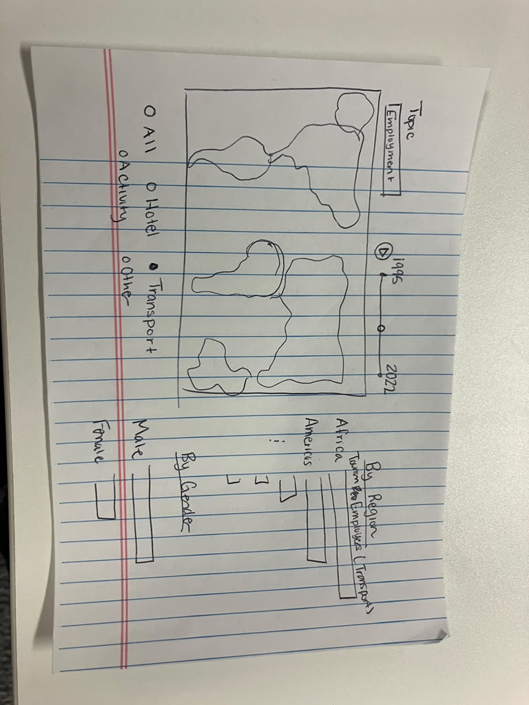

# Eliana Nowlis

## Description

In my interactive project I would like to give the user a way to explore the UN tourism data through visualizations. My idea is to have a dashboard that is centered around a map with supporting graphics (likely bar graphs) around it. The user could choose parameters such as year, topic (employment, inbound tourism, outbound tourism, etc.) and potentially specify certain regions or countries through sliders and drop down menus. This allows the user to gain an understanding of the data without having to read through Excel files or make their own visualizations. I also might add functionality to let the user click play and watch how their chosen metric changes over time.

## Technical Plan re: Option A/B/C/D

I believe that the project I have in mind is closest to Option A, as I would like all my graphics to change together based on a user's selection. I plan to use D3.js because my map will be largely, if not entirely, chloropleth, and I want to practice using this library.

I plan to draw inspiration from the following pieces:
- Evidence-Based Funding Formula Equity Dashboard (https://www.advanceillinois.org/evidence-based-funding-formula-equity-dashboard-2021). I want my dashboard to be similar to this one, where the user chooses year and type of data and all visualizations are updated. I also like the use of zooming, tooltips, and highlighting specific counties once clicked.
- Migration in Motion (https://paula-cadena.github.io/migration/country.html). I was inspired by this visualizations when looking at prior examples. I like how the bar chart provides context to the map and that it feels fun to play around with the data. I will think about incorporating hover functionality in my final project.

## Mockup

## Data Sources

### Data Source 1: UN Tourism

URL: https://www.untourism.int/tourism-statistics/tourism-statistics-database

Size: 197,778 rows, 14 columns

UN Tourism contains tourism statistics from countries and territories around the
world, from 1995 to 2024. The data was originally stored in separate excel files,
but I stacked them into one master dataset. The stacked data contains 151 different
indicators including things like total employment in tourism industries, number
of domestic trips, and average length of stay.

## Questions

1. My idea for how to approach this is to start with some simple interactivity and keep adding on more depending on how much time I have to do this project. I could see myself ending up adding a lot of different way to interact with this data. Is there a danger of doing too much? And how do I know when to stop?